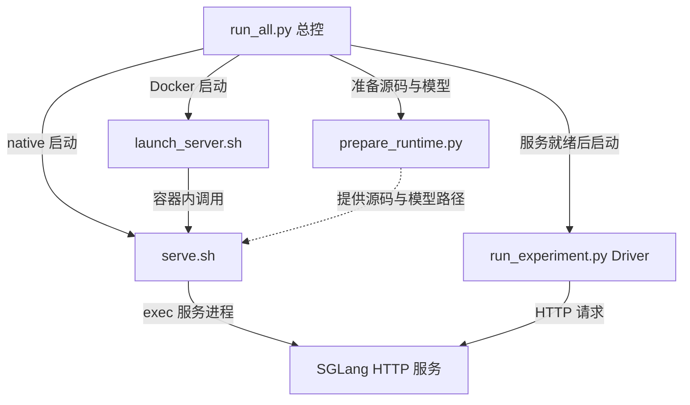

# HiCache 恢复实验

比较相同输入 P+S 的 Cold、GPU L1 命中和 CPU L2 恢复性能。P 是历史 Prefix，S 是新增 Suffix；`1K=1024 tokens`。

可通过总控运行完整任务，也可分别使用三个下层入口：

| 入口 | 职责 | 在哪里运行 |
|---|---|---|
| `run_all.py` | 自动准备源码/模型、开服务、测试、校验结果并清理服务 | 云实例内部，或 Docker 宿主机 |
| `launch_server.sh` | 创建 Docker 容器，挂载模型/源码，调用 `serve.sh`，管理本次容器 | 有 Docker 和 NVIDIA runtime 的宿主机 |
| `serve.sh` | 统一 SGLang 参数，在当前 Python 环境启动服务 | 已有环境的服务器或云容器内部 |
| `run_experiment.py` | 通过 HTTP 构造缓存状态、测量、校验、统计和绘图 | 任意能连接服务的客户端 |

服务参数可保存为 `configs/serve/<名称>.yaml`；`serve_config.py` 和 `launch_metadata.py` 是共用的内部解析/记录工具。



总控分别启动服务和 Driver；Docker 模式由总控通过 `docker exec` 启动 Driver。Driver 发起 HTTP 请求并读取响应，SGLang 不启动 Driver。
三个下层入口均可独立使用。逐文件职责、共享工具和配置关系见 [项目架构](docs/architecture.md)。

[一键云任务](docs/cloud-task.md) · [分步部署](docs/deployment.md) · [实验用法与指标](docs/usage.md) · [逐轮实验记录](docs/experiments/README.md)

Qwen3.5 混合注意力模型使用同一入口，支持 TP=1/2/4、EP=1/TP 的 Cold/L1/L2；本地模型、Docker 和 122B 长前缀用法见 [Qwen3.5 实验](docs/qwen35.md)。

## 一键运行

已有 SGLang 依赖环境（例如官方镜像创建的 Vast 实例）时：

```bash
python3 -m pip install -r requirements-launch.txt
python3 run_all.py qwen3-8b-smoke --dry-run
python3 run_all.py qwen3-8b-smoke --run-id smoke-001
```

只有 Docker 环境时使用 `GPU=0 python3 run_all.py qwen3-8b-smoke --runtime docker`。
任务自动准备固定版本的 SGLang 源码并应用仓库内补丁，下载/复用固定版本模型，完成 P=2K/S=128 的三组各 3 次测量，再停止本次服务。
结果保存在 `results/<run-id>/`，用 `run.json` 查看状态和失败阶段；原始数据、CSV 和图表位于 `samples/`。
模型只需两种用法：指定 `--model-dir` / `MODEL_DIR` 就检查该目录、缺文件自动补齐；不指定就使用 HF 库返回的默认缓存路径，通常位于 `~/.cache/huggingface/hub`。
总控不再使用 `MODEL_ROOT`。HF 缓存位置沿用 `HF_HOME` / `HF_HUB_CACHE`，由 HF 库处理。
源码缓存默认放项目 `.cache/`（可用 `HICACHE_CACHE_DIR` 修改），结果目录可用 `RESULTS_DIR` 指向持久卷。
部署前需已有对应 GPU 驱动及推理依赖；脚本不管理云实例计费。详见 [一键云任务](docs/cloud-task.md)。

## 1. 启动服务：二选一

先准备完整模型目录。L2 和 GPU 计时需要带本地实验补丁的 SGLang；官方镜像本身不包含该补丁。
使用当前仓库的相邻 `../sglang` 时会自动加载该源码，也可显式设置 `SGLANG_DIR`。

手工启动服务时设置完整模型目录，命名配置只需要轻量 YAML 依赖：

```bash
python3 -m pip install -r requirements-launch.txt
export MODEL_DIR=/workspace/models/Qwen3-8B
bash serve.sh --list-configs
```

已有环境（包括 Vast 普通容器）直接启动；需要 Docker 时使用另一个入口，二选一：

```bash
# 当前环境，直接使用 MODEL_DIR 中准备好的模型。
RUN_ID=server-demo bash serve.sh qwen3-8b-4k

# Docker：镜像须提前下载，宿主机需有 NVIDIA runtime。
GPU=0 RUN_ID=server-demo CONTAINER_NAME=hicache-demo \
  bash launch_server.sh qwen3-8b-4k
```

该配置开启 HiCache 和 GPU 计时，使用 BF16、TP=1、总上下文 4096、KV 池 8192、CPU 池 8 GB。
两种方式均监听 `127.0.0.1:39081`，chunk=4096、page size=1、Graph 关闭、overlap 开启。
启动记录保存在 `results/server-demo/`。长期运行可放在 `tmux` 中；Docker 入口退出时清理其创建的容器。

```bash
# 临时覆盖：命令行 > 显式环境变量 > 配置文件。
bash serve.sh qwen3-8b-4k --mem-fraction-static 0.85
bash serve.sh qwen3-8b-4k --dry-run
```

完整规则与新增配置示例见 [命名服务配置](docs/deployment.md#命名服务配置)。手工启动须指定配置名，环境变量可覆盖该配置。

## 2. 客户端执行实验

客户端不需要模型权重、SGLang、Docker 或 GPU；需要与服务端匹配的 tokenizer 文件。
服务和客户端在同一环境时可直接把完整模型目录作为 tokenizer 目录。

```bash
python3 -m pip install -r requirements-client.txt
python3 run_experiment.py run \
  --base-url http://127.0.0.1:39081 \
  --tokenizer /path/to/Qwen3-8B-tokenizer \
  --output-dir results/samples-demo \
  --prefix-lengths 2k --suffix-lengths 128 \
  --groups cold l1 l2 --output-length 1 --repeats 3 --gpu-timing
```

也可在上述 Docker 容器内运行，省去客户端环境安装：

```bash
docker exec --user "$(id -u):$(id -g)" hicache-demo \
  python /experiment/run_experiment.py run \
  --base-url http://127.0.0.1:39081 --tokenizer /model \
  --output-dir /results/samples-demo \
  --prefix-lengths 2k --suffix-lengths 128 \
  --groups cold l1 l2 --repeats 3 --gpu-timing
```

这里用 P=2K 验收：配置名中的 4K 是总上下文，必须容纳 P、S 和输出。
多项 P/S 自动组成矩阵；每个组合先预热，再收集指定数量的有效样本，每次重新准备缓存。
仅测 L1 时设置 `--groups l1`。服务应专供本轮实验，单请求、并发 1。
远程机器通过 [SSH 隧道](docs/deployment.md#远程客户端) 使用相同 Driver；当前缓存控制接口只接受服务端 loopback 连接。

## 常用参数

| 配置 | 位置 | 含义 |
|---|---|---|
| `MODEL_ROOT`、`MODEL_DIR`、`SGLANG_DIR` | 两个启动入口 | 模型根目录、完整模型目录覆盖、源码 checkout；`SGLANG_DIR=''` 使用安装包 |
| `GPU` | 启动入口 | Docker 选择物理卡；直接启动设置可见卡，省略则继承环境 |
| `DTYPE`、`KV_DTYPE`、`TP`、`EP` | `serve.sh` | 权重/KV 精度与 TP/EP；支持 TP=1/2/4、EP=1/TP，PP=DP=1 |
| `CONTEXT_LENGTH`、`MAX_TOTAL_TOKENS`、`MEM_FRACTION` | 启动环境，可覆盖配置 | 默认值来自所选 YAML |
| `HICACHE`、`HICACHE_SIZE`、`FORWARD_TIMING` | 启动环境，可覆盖配置 | 默认值来自所选 YAML；GPU 计时需开启 HiCache |
| `--base-url`、`--tokenizer`、`--output-dir` | Driver | 服务地址、客户端 tokenizer、客户端结果目录 |
| `--server-artifacts` | Driver，可选 | 客户端可读的启动记录目录或其副本，不要求共享磁盘 |
| `--profile --server-profile-dir /path` | Driver，诊断用 | 在服务端指定路径写 trace；正式扫描关闭 Profiler |

额外 SGLang 参数直接追加给任一启动入口。`--help` 查看用法，`--dry-run` 检查最终命令而不启动服务。

## 输出与当前边界

`config.json`、`inputs.json`、`responses.jsonl`、`samples.csv`、`summary.csv`、图表和 Driver 快照保存在测量目录。
可选启动记录包括源码版本、补丁、镜像 ID、启动命令和日志。实验记录写在 `docs/experiments/`；原始数据放 `results/`，不纳入 Git。总控的源码统一在 `code/`，服务证据在 `server/`；`samples/config.json` 用相对路径引用它们。

```bash
python3 run_experiment.py analyze results/samples-demo
# 无绘图库也可重新汇总 CSV：
python3 run_experiment.py analyze results/samples-demo --no-plot
```

命中、长度、回撤、输出和实际 H2D 传输量均需满足检查；异常尝试保留但不计入统计。
计时单位为 ms。`prefill_forward_gpu_ms` / `kv_load_ms` 是 GPU 流区间，可包含等待并互相重叠；客户端延迟包含网络。
Median/P95 基于有效样本，P95 使用线性插值；[完整定义](docs/usage.md#指标含义)。

总控支持自动准备、服务启动、矩阵采样、校验、绘图和服务清理；遥测编排、正式样本断点续跑及云实例计费回收仍独立处理。
Prefix lookup 独立时间尚未导出。真实 GPU 和新云平台需各自验收，CPU 自测不能替代。

```bash
bash -n launch_server.sh serve.sh
python3 -m unittest discover -s tests -v
```
