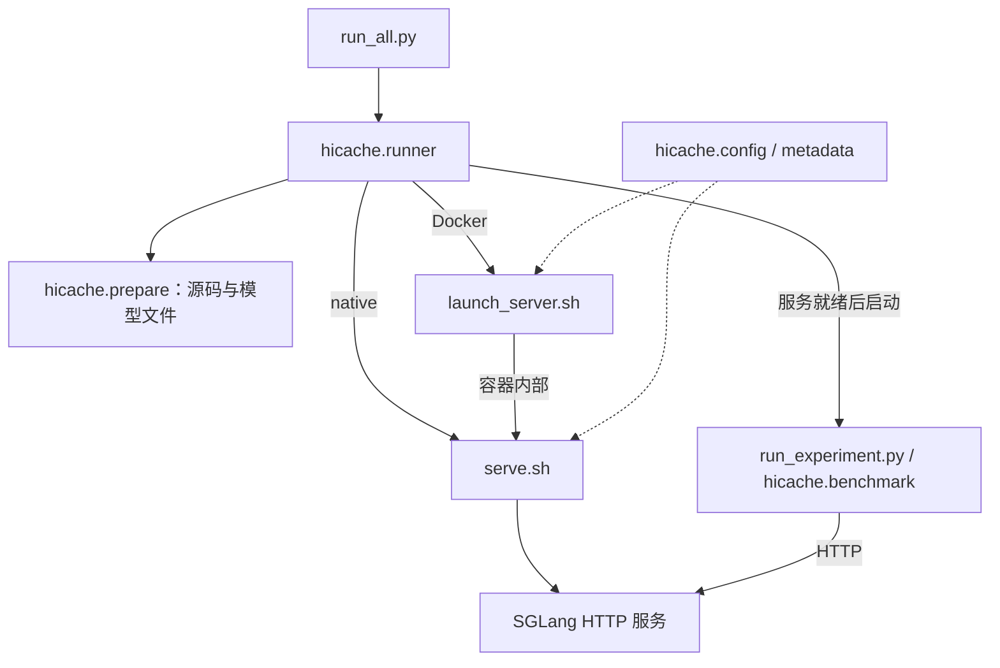

# 仓库结构与调用关系

[入口](../README.md) · [云任务](cloud-task.md) · [部署](deployment.md) · [协议与指标](usage.md)

本工程负责启动编排和 HTTP 实验；模型计算、专家路由和缓存操作在配套 SGLang 中执行。

## 从哪里读

| 文件 | 职责 |
|---|---|
| [run_all.py](../run_all.py) | 完整任务的薄命令入口 |
| [run_experiment.py](../run_experiment.py) | 独立采样和分析的薄命令入口 |
| [hicache/config.py](../hicache/config.py) | 合并配置、参数定义、模式选择和 Graph 桶计划 |
| [hicache/prepare.py](../hicache/prepare.py) | 固定源码准备、HF 路径、dummy 小文件或真实权重 |
| [hicache/runner.py](../hicache/runner.py) | Job：冻结、准备、启动、等待、采样、验收和清理 |
| [hicache/benchmark.py](../hicache/benchmark.py) | Client、输入、缓存准备、逐点采样和输出校验 |
| [hicache/metrics.py](../hicache/metrics.py) | 所有 rank 的状态、指标等待、差值和 Graph 路径检查 |
| [hicache/results.py](../hicache/results.py) | CSV 格式、统计和绘图 |
| [hicache/metadata.py](../hicache/metadata.py) | 启动记录与统一包源码快照 |
| [tools/diagnostics.py](../tools/diagnostics.py) | 可选遥测和 trace 分析 |

修改采样步骤，从 run_samples → execute_sample → validate 读起；修改运行生命周期看 Job.execute。两个 Shell 入口只负责环境和服务进程，不执行采样。

## 调用关系

Docker 总控通过 docker exec 启动 Driver；服务与 Driver 是独立进程。独立使用服务入口后，也可另开终端运行 HTTP Driver。

## 一份实验配置

configs/experiments/<名称>.yaml 包含：

- model：HF 仓库与完整 revision。
- server：load-format、routing、prefill-graph，以及 env 和原生 sglang 参数。
- test：P/S、cold/L1/L2、重复次数和计时选项。

总控的 CLI 覆盖 YAML，部署环境可覆盖明确支持的容量、地址、GPU 等参数；最终设置冻结后，启动器不再重新合并环境。Graph 桶在最终 P/S、组别和 chunk 确定后生成。

两个独立服务入口也读取相同配置名，使用 YAML 的 test 网格生成桶；通过原生 CLI 可临时覆盖服务参数。它们要求 MODEL_DIR 或 --model-path 指向已经准备的完整目录，不再使用 MODEL_ROOT。

configs/runtime.lock.json 单独固定 SGLang 基线、补丁和镜像。总控校验补丁并复用匹配 checkout；独立服务入口不会自动应用版本锁，需提供对应 SGLANG_DIR。显式 SGLANG_DIR='' 使用环境安装包，但该包须具备所需实验接口。

## 文件准备和运行数据

dummy 只访问明确白名单中的配置/tokenizer/processor，不检查权重分片；auto 保留完整权重检查和补齐。两者使用同一个 HF revision 与量化配置。未指定 MODEL_DIR 时沿用 HF 库返回的缓存路径；Docker 挂载 HF 缓存根以保留共享 blobs 的相对链接。

.cache/ 保存可复用的源码与锁；results/ 保存每次运行的证据，两者不进入 Git。HICACHE_CACHE_DIR 与 RESULTS_DIR 可以修改其根目录。

总控只保存一份 code/，包含两个 Python 入口、Shell 和完整包结构。server/ 与 samples/ 引用该副本。独立启动或客户端运行才各自创建必要快照；不维护几份不同的依赖文件清单。

## 验证边界

HTTP 返回不表示所有 rank 的 CUDA Event 已发布。指标模块检查预期计数并保留 400 ms 稳定窗口，等待位于测量请求之外；它不是服务端提交完成 ACK。完整 Prometheus 文本仅在内存解析。

正式 Graph 请求检查每个 rank 的 Graph/eager 次数；准备和 reference 不要求相同路径。Graph 捕获桶是计划配置，计数器是实际执行证据，二者分别记录。

Qwen3.5 的 P 检查点同时包含 KV 与 GDN 状态，不能仅凭 cached_tokens 推断正确。控制接口、命中、实际计算量与传输验收见 [协议](usage.md)。

CPU 回归检查编排和协议，不能证明 CUDA 性能。历史 GPU 实验以 [各轮归档](experiments/README.md) 为准，新模式的 GPU 验收另行记录。
